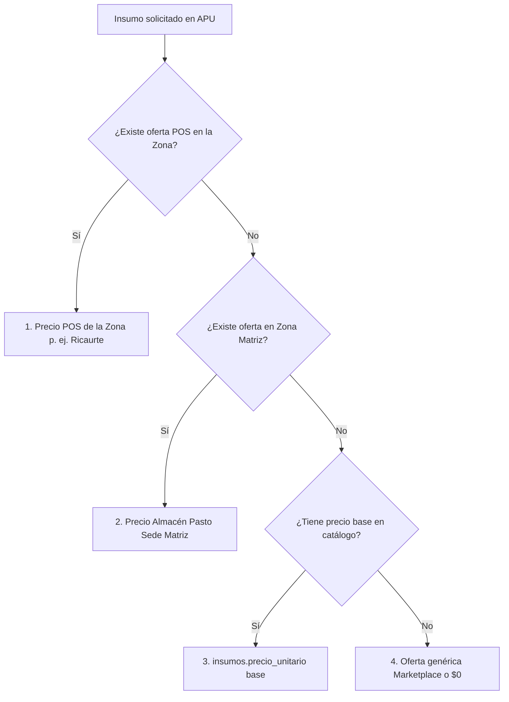
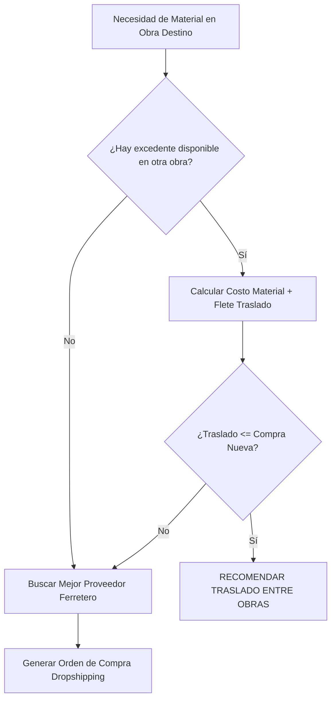
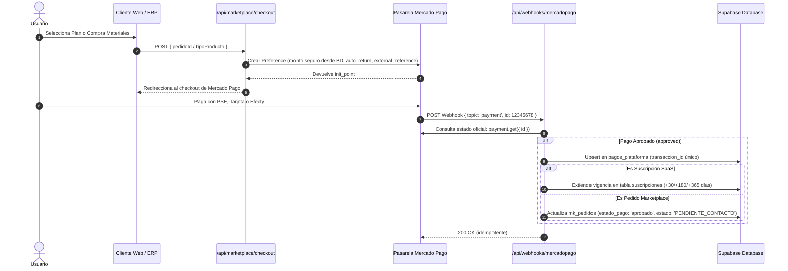
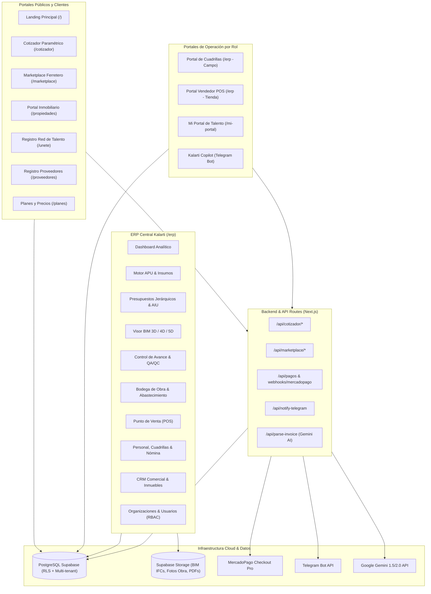

# 🏛️ Manual Técnico Maestro: Arquitectura, Lógica Matemática, Seguridad y Ecosistema Kalarti ERP

**Versión de la Plataforma:** 0.22.0 (Fases 1 a 22a)  
**Clasificación:** Manual de Arquitectura Integral, Especificaciones Matemáticas y Runbook Operativo  
**Tecnologías:** Next.js 16.2.4 (App Router) + Supabase PostgreSQL (Multi-tenant RLS) + ThatOpen BIM 3D/4D/5D + Mercado Pago Checkout Pro + Google Gemini AI + Telegram Bot API  
**Última Actualización:** Octubre 2026  

---

## Índice de Contenidos
1. [Visión General y Mapa de Documentación Existente](#1-visión-general-y-mapa-de-documentación-existente)
2. [Motor Matemático, Factor Prestacional y Cascada de APU Geográfica](#2-motor-matemático-factor-prestacional-y-cascada-de-apu-geográfica)
3. [Cadena Logística, Abastecimiento y Dropshipping con Comisión](#3-cadena-logística-abastecimiento-y-dropshipping-con-comisión)
4. [Seguridad, Base de Datos, Multi-Tenancy y Políticas RLS](#4-seguridad-base-de-datos-multi-tenancy-y-políticas-rls)
5. [Integraciones Transaccionales y Motor de Inteligencia Artificial](#5-integraciones-transaccionales-y-motor-de-inteligencia-artificial)
6. [Estructura de Directorios del Repositorio](#6-estructura-de-directorios-del-repositorio)
7. [Arquitectura Global del Ecosistema](#7-arquitectura-global-del-ecosistema)
8. [Diccionario de Datos Operativo y Vistas SQL](#8-diccionario-de-datos-operativo-y-vistas-sql)
9. [Matriz de Variables de Entorno del Ecosistema](#9-matriz-de-variables-de-entorno-del-ecosistema)
10. [Manual de Puesta en Marcha (Runbook Técnico)](#10-manual-de-puesta-en-marcha-runbook-técnico)

---

## 1. Visión General y Mapa de Documentación Existente

Todos los planes, walkthroughs de verificación y scripts de migración previos generados a lo largo del desarrollo se conservan en el workspace:

### 1.1 Bitácoras de Fases (Walkthroughs Históricos)
- [Fase-1_walkthrough.md](../Fase-1_walkthrough.md): Cimientos del ERP, Base de datos inicial, CRUD de Insumos y Gestor de APU con cálculo recursivo.
- [Fase-2_walkthrough.md](../Fase-2_walkthrough.md): Motor de Presupuestos, Capítulos jerárquicos, Lógica de cálculo AIU, importador CSV de Revit y exportador PDF.
- [Fase-3_walkthrough.md](../Fase-3_walkthrough.md): Visor BIM 3D nativo en navegador con `@thatopen/components`, Three.js y Web-IFC WASM.
- [Fase-4_walkthrough.md](../Fase-4_walkthrough.md): Conexión Supabase cloud (`hnbssxtdagzrbedrdynn`), persistencia y autenticación JWT.
- [Fase-5_walkthrough.md](../Fase-5_walkthrough.md): BIM 5D (Vínculo de elementos 3D con ítems de presupuesto en Supabase) + Importación masiva desde Excel + Dashboard analítico.
- [Fase-6_walkthrough.md](../Fase-6_walkthrough.md): Centro de Reportes Multi-formato (Excel profesional dinámico con ExcelJS y PDF con AutoTable).
- [Fase-7_walkthrough.md](../Fase-7_walkthrough.md): BIM 4D y Control de Avance de Obra en tiempo real (semáforo de coloración 3D en modelo IFC por porcentaje/cantidad).
- [walkthrough_Colaboracion avanzada.md](../walkthrough_Colaboracion%20avanzada.md): Portal de Cuadrillas móvil, QA/QC, checklist ponderado %, hilos de discusión y evidencia fotográfica obligatoria.

### 1.2 Planes de Arquitectura e Implementación Avanzada
- [copilot_plan.md](../copilot_plan.md): Arquitectura conversacional del Bot de Telegram por roles (Admin, Campo, Cuadrilla, Cliente) y sincronización CRM.
- [implementation_plan_Marketplace.md](../implementation_plan_Marketplace.md) (y fases 2, 2_a, 2_b): Red ferretera, Punto de Venta (POS), checkout de materiales y catálogo multi-proveedor.
- [implementation_plan_personal_proyectos.md](../implementation_plan_personal_proyectos.md) / [implementation_plan_refinamiento_personal.md](../implementation_plan_refinamiento_personal.md): Cuadrillas operativas, Factor Prestacional colombiano y nómina de obra.
- [implementation_plan_subscriptions.md](../implementation_plan_subscriptions.md): Modelo SaaS, suscripciones (Free, Pro, Constructor, Empresarial) y pasarela Mercado Pago.
- [marketing/plan_hibrido_kalarti_afiliados.md](../marketing/plan_hibrido_kalarti_afiliados.md): Estrategia de crecimiento híbrido y captación de leads.

### 1.3 Registro de Migraciones SQL en Supabase
Ubicados en `erp-construccion/`:
- `supabase-schema.sql`: Tablas base iniciales (Fases 1 a 4).
- `migration-fase14-marketplace.sql` y `migration-fase14-pedidos-update.sql`: Marketplace, órdenes de compra y checkout.
- `migration-fase15-productos.sql`: Catálogo ferretero y Punto de Venta (POS).
- `migration-fase16-inmuebles.sql`: Portal inmobiliario y comercialización de proyectos.
- `migration-fase17-cotizador.sql`: Cotizador paramétrico público y proyectos guardados.
- `migration-fase18-proveedores-agenda.sql`: Agenda de citas y entregas POS con proveedores.
- `migration-fase19-catalogo.sql`: Taxonomía y catálogo estándar de insumos colombianos.
- `migration-fase20-red-logistica.sql`: Red logística de abastecimiento y zonificación.
- `migration-fase21-abastecimiento-zonas.sql`: Cobertura municipal, asignación de bodegas y vista `v_abastecimiento_proyecto`.
- `migration-fase22a-tenancy-rls.sql`: Arquitectura Multi-Tenant (`organizaciones`, `organizacion_miembros`) y endurecimiento de seguridad RLS.
- `migration-fase22-ecosistema-talento.sql`: Red Bidireccional de Talento, cuadrillas ociosas B2B y convocatorias públicas de licitación.

---

## 2. Motor Matemático, Factor Prestacional y Cascada de APU Geográfica

El cálculo financiero descansa en funciones puras aisladas de la interfaz gráfica, centralizadas en `src/lib/apu-engine.js` y `src/components/FactorPrestacionalPanel.js`.

### 2.1 Desglose del Factor Prestacional Colombiano (Normativa Vigente)
La mano de obra formal en la construcción colombiana (Sector Obras / Edificaciones) no puede calcularse simplemente dividiendo el salario por 30 días. Debe incorporar los sobrecostos de ley, seguridad social para actividades de alto riesgo y dotación.

El sistema parametriza los factores prestacionales según la siguiente formulación base para el año 2026:
- $\text{SMLV}_{2026} = \$1.750.905\text{ COP}$
- $\text{Subsidio de Transporte} = \$200.000\text{ COP}$
- $\text{Jornada Mensual} = 240\text{ horas}$ ($30\text{ días} \times 8\text{ horas/día}$)

#### Tabla de Componentes Prestacionales:
| Concepto Prestacional / Parafiscal | % Legal sobre Salario Base | Obreros 1 SMLV | Obreros 1.5 SMLV | Empleados / Profesionales |
|---|---|---|---|---|
| **Cesantía anual** | 8.33% | 8.33% | 8.33% | 8.33% |
| **Intereses sobre cesantía** | 1.00% | 1.00% | 1.00% | 1.00% |
| **Prima de servicios** | 8.33% | 8.33% | 8.33% | 8.33% |
| **Vacaciones** | 4.17% | 4.17% | 4.17% | 4.17% |
| **Salud patronal (EPS)** | 8.50% | 8.50% | 8.50% | 8.50% |
| **Pensión patronal** | 12.00% | 12.00% | 12.00% | 12.00% |
| **ARL (Riesgo V Construcción)** | 6.96% | 6.96% | 6.96% | 6.96% |
| **Caja de Compensación Familiar** | 4.00% | 4.00% | 4.00% | 4.00% |
| **ICBF** | 3.00% | 3.00% | 3.00% | 3.00% |
| **SENA** | 2.00% | 2.00% | 2.00% | 2.00% |
| **Subsidio de transporte dinámico** | $\frac{\text{Subsidio}}{\text{SMLV} \times n}$ | 11.42% | 7.62% | 0.00% |
| **Dotación industrial y EPP** | Específica obra | 7.29% | 5.09% | 0.71% |
| **Factor Multiplicador Total ($F_{\text{mult}}$)** | **$1 + \sum \%_i$** | **1.77** | **1.71** | **1.59** |

### 2.2 Costo Horario y Composición de Cuadrillas
El motor evalúa cargos simples o cuadrillas compuestas recursivas:
1. **Cargo Individual (sin integrantes):**
   $$\text{Valor Hora} = \frac{\text{SMLV} \times (\text{Factor SMLV} \times F_{\text{mult}} \times \text{Factor Zona})}{240\text{ h}} + \frac{\text{Recargo COP}}{240\text{ h}}$$
2. **Cuadrilla Compuesta:**
   Una cuadrilla (ej: *Oficial + 2 Ayudantes*) suma el costo de cada integrante:
   $$\text{Costo Hora Base} = \sum_{j} \left( \frac{\text{SMLV} \times F_j}{240} \right) \times \text{Cantidad}_j$$
   $$\text{Precio Hora Cuadrilla} = (\text{Costo Hora Base} \times F_{\text{mult}}) \times (1 + \%_{\text{recargo}}) + \frac{\text{Recargo COP}}{240}$$

### 2.3 Cascada Geográfica de Precios: Pasto vs. Ricaurte / Costa Nariñense
Un problema crítico resuelto en `apu-engine.js` es la variabilidad de costos entre la sede matriz y los frentes de obra periféricos. Por ejemplo, en **Ricaurte / Mallama** (zona de ladera y piedemonte costero de Nariño), los costos de mano de obra aumentan por viáticos/clima, y los insumos comerciales deben incluir el flete o el precio del distribuidor local.

#### Jerarquía de Fallback Cuádruple en Precios de Insumos:


#### Modificador de Mano de Obra por Zona (`MO_ZONAS`):
Configurado en `global_config`:
```json
{
  "ricaurte": {
    "factor_general": 1.10,
    "cargos": {
      "MO-OFI": 1.15
    }
  }
}
```
Si el proyecto está asignado a "Ricaurte", todo oficial de obra automáticamente aplica un $1.15$ ($+15\%$) y el resto del personal un $1.10$ ($+10\%$) sobre el valor base de Pasto.

### 2.4 Evaluación Recursiva de APUs (Básicos y Compuestos)
La función `costoAPU(ctx, apuId, visited)` recorre el árbol de detalles:
- **Materiales:** $\text{Cantidad} \times (1 + \frac{\%_{\text{desperdicio}}}{100}) \times (\text{Precio Insumo} \times \text{Factor Conversión})$.
- **Mano de Obra:** $\text{Rendimiento (horas)} \times \text{Precio Hora Cargo}$.
- **Herramienta Menor:** Calculada automáticamente como un porcentaje directo sobre el valor parcial de la mano de obra ($\%_{\text{herramienta}} \times \text{MO}$), agregándose al bucket de **Equipos**.
- **APUs Básicos anidados:** Se evalúan recursivamente garantizando prevención de ciclos mediante un conjunto `visited = new Set()`.

---

## 3. Cadena Logística, Abastecimiento y Dropshipping con Comisión

La arquitectura logística opera bajo el concepto de **Red Distribuida de Obras sin Bodega Central Fija** (`src/lib/compras-engine.js`). Cada obra tiene su propia bodega virtual y física.

### 3.1 Balance Dinámico de Stock en Obra
El estado de cada insumo en una bodega se calcula con la fórmula:
$$\text{Stock Existente} = \sum \text{Entradas} - \sum \text{Salidas}$$
$$\text{Stock Comprometido} = \sum \text{Órdenes de Traslado Pendientes}$$
$$\text{Stock Disponible} = \text{Stock Existente} - \text{Stock Comprometido}$$
$$\text{Costo Unitario} = \text{Promedio Ponderado de Entradas}\ (\text{CPP})$$

### 3.2 Algoritmo `resolverAbastecimiento`: Traslado vs. Compra
Cuando el presupuesto programado demanda material para una fecha determinada, el algoritmo evalúa dos caminos:



#### Parámetros del Algoritmo:
1. **Flete de Traslado Paramétrico:**
   - Mismo municipio: $\$60.000\text{ COP}$.
   - Diferente municipio: $\$180.000\text{ COP}$ (ej: Pasto $\rightarrow$ Ricaurte).
2. **Matriz de Proveedores (`mejorCotizacion`):**
   - Filtra proveedores activos con cotización vigente para el insumo.
   - Prioriza cobertura municipal $\rightarrow$ Stock disponible $\rightarrow$ Menor precio de compra.
3. **Cálculo de Despacho Óptimo:**
   - La fecha de colocación del pedido se calcula automáticamente descontando los días de entrega en días hábiles (excluyendo domingos):
   $$\text{Fecha Pedido} = \text{Fecha Necesidad} - \text{Tiempo Entrega (días hábiles)}$$

### 3.3 Marketplace Ferretero y Dropshipping con Comisión
Implementado en `src/components/PedidosMarketplaceView.js`:
- **Venta al Comprador:** Precio catálogo en tienda web.
- **Asignación del Proveedor:** El sistema vincula la ferretería más económica que cubra el municipio de despacho.
- **Margen de Comisión Kalarti:**
  $$\text{Comisión Neta} = \text{Total Venta Web} - \text{Costo Facturado por el Proveedor}$$
- **Sobrantes de Obra:** Si el material proviene de un excedente inventariado de una obra propia, la comisión se marca como `Ingreso de Obra`, monetizando activos ociosos.
- **Integración con WhatsApp:** Generación instantánea del deep link con mensaje formateado:
  `"Hola [Ferretería], requiero despachar [X und] [Producto] a la dirección [Destino]. Confírmame disponibilidad. OC [Número]"`

---

## 4. Seguridad, Base de Datos, Multi-Tenancy y Políticas RLS

Toda la persistencia reside en PostgreSQL (Supabase) bajo un esquema multi-tenant formalizado en `migration-fase22a-tenancy-rls.sql`.

### 4.1 Entidades del Modelo Multi-Tenant
- `organizaciones`: Entidad legal (Constructora, Comercio, Proveedor) con slug único, NIT y plan SaaS.
- `organizacion_miembros`: Tabla intermedia que enlaza `profile_id` con `organizacion_id` y define privilegios (`ADMIN` o `MIEMBRO`).
- `profiles`: Persona única (auth user) que almacena la `organizacion_activa_id` y un array de `roles`.

### 4.2 Funciones Almacenadas de Seguridad (SECURITY DEFINER)
Para evitar la recursión infinita en las políticas RLS y blindar la sesión, se crearon funciones en el esquema `public`:

```sql
-- 1. IDs de las organizaciones a las que pertenece el usuario autenticado
CREATE OR REPLACE FUNCTION public.mis_organizaciones()
RETURNS SETOF UUID LANGUAGE sql STABLE SECURITY DEFINER SET search_path = public AS $$
  SELECT organizacion_id FROM organizacion_miembros WHERE profile_id = auth.uid();
$$;

-- 2. Verificación si el usuario es administrador de una organización específica
CREATE OR REPLACE FUNCTION public.es_admin_org(p_org UUID)
RETURNS BOOLEAN LANGUAGE sql STABLE SECURITY DEFINER SET search_path = public AS $$
  SELECT EXISTS (
    SELECT 1 FROM organizacion_miembros 
    WHERE organizacion_id = p_org AND profile_id = auth.uid() AND rol = 'ADMIN'
  );
$$;

-- 3. Super-administrador de la plataforma Kalarti (correos corporativos o Admin de Kalarti SAS)
CREATE OR REPLACE FUNCTION public.is_kalarti_admin()
RETURNS BOOLEAN LANGUAGE sql STABLE SECURITY DEFINER SET search_path = public AS $$
  SELECT
    coalesce(lower(auth.jwt() ->> 'email'), '') LIKE '%@kalarti.com'
    OR lower(coalesce(auth.jwt() ->> 'email', '')) IN (
      'gsalo90@outlook.com', 'guillermosalomonsolarte@gmail.com', 'arq.guillermo_salomon@kalarti.com'
    )
    OR EXISTS (
      SELECT 1 FROM organizacion_miembros m
      WHERE m.profile_id = auth.uid() AND m.rol = 'ADMIN' AND m.organizacion_id = public.kalarti_org_id()
    );
$$;
```

### 4.3 Triggers de Auto-Aislamiento y Protección de Privilegios
1. **Trigger `set_organizacion_id()`:**
   Intercepta inserciones en tablas operativas (`proyectos`, `presupuesto_items`, `obra_avances`, `personal`, `bodegas`, etc.). Si la fila no trae `organizacion_id`, le inyecta automáticamente la organización activa del usuario.
2. **Trigger `profiles_proteger_roles()`:**
   Impide que un usuario estándar modifique su propio registro en `profiles` para asignarse el rol `ADMIN` de forma arbitraria.

### 4.4 Matriz de Políticas RLS Activas:
| Tabla / Agrupación | Tipo de Acceso | Política RLS (Expresión SQL) |
|---|---|---|
| **Catálogo Compartido** (`insumos`, `apu`, `cargos`, `categorias`) | Lectura Pública | `FOR SELECT USING (true)` |
| **Catálogo Compartido** | Escritura | `FOR ALL USING (public.es_staff_kalarti())` |
| **Tablas Operativas de Obra** (`proyectos`, `presupuesto_items`, `obra_avances`, etc.) | Multi-tenant | `FOR ALL USING (organizacion_id IN (SELECT public.mis_organizaciones()) OR public.is_kalarti_admin())` |
| **Personal & Nómina** (`personal`) | Multi-tenant + Ficha Propia | `profile_id = auth.uid() OR organizacion_id IN (SELECT public.mis_organizaciones()) OR public.is_kalarti_admin()` |
| **Perfiles de Usuario** (`profiles`) | Privacidad Estricta | `id = auth.uid() OR public.es_staff_kalarti() OR id IN (SELECT profile_id FROM organizacion_miembros WHERE organizacion_id IN (SELECT public.mis_organizaciones()))` |

---

## 5. Integraciones Transaccionales y Motor de Inteligencia Artificial

### 5.1 Mercado Pago Checkout Pro (Suscripciones, Exportación y Marketplace)
El backend procesa pagos en moneda local colombiana (COP) con arquitectura basada en webhooks idempotentes:



#### Archivos Responsables:
- `src/app/api/webhooks/mercadopago/route.js`: Manejo de pagos SaaS y compras de cotizador.
- `src/app/api/marketplace/webhook/route.js`: Despacho de pedidos de materiales.

### 5.2 Digitalización de Remisiones con Visión Artificial (Google Gemini AI)
Ubicado en `src/app/api/parse-invoice/route.js`:
- **Motor:** `@google/generative-ai` ejecutando el modelo `gemini-2.5-flash`.
- **Funcionamiento:**
  1. Recibe la fotografía o PDF de una remisión física tomada en el frente de obra desde el teléfono.
  2. Convierte el archivo a `base64` e inyecta un prompt estructurado al modelo.
  3. Extrae: Proveedor / Ferretería, Insumos detectados, Cantidad y Costo unitario.
  4. Obliga a Gemini a responder en formato JSON estricto sin bloques Markdown envolventes.
  5. Carga directamente los ítems en la tabla `inventario_transacciones` de la bodega de la obra como entradas aprobadas.

### 5.3 Kalarti Copilot: Asistente Conversacional en Telegram
Ubicado en `erp-construccion/telegram-bot/`:
- **Detección Contextual por Rol:**
  - **Admin:** Resumen financiero del día, porcentaje de ejecución de proyectos, novedades críticas.
  - **Cuadrilla:** Solicitud de check-in georreferenciado por GPS a las 7:00 AM, tareas asignadas del día y registro fotográfico de avance.
  - **Cliente:** Asistente comercial para cotizaciones paramétricas de vivienda.

---

## 6. Estructura de Directorios del Repositorio

```
ERP_Construccion/
├── DOCUMENTACION_SISTEMA.md                        # Este documento maestro
├── Fase-1_walkthrough.md a Fase-7_walkthrough.md   # Bitácoras históricas detalladas
├── walkthrough_Colaboracion avanzada.md            # Supervisión y cuadrillas QA/QC
├── copilot_plan.md & implementation_plan_*.md      # Diseños funcionales por subsistema
├── marketing/                                      # Campañas, ads, landing pages SEO y WhatsApp
└── erp-construccion/                               # Código Fuente Principal Next.js
    ├── package.json                                # Dependencias y scripts
    ├── supabase-schema.sql                         # Esquema de tablas base
    ├── migration-fase*.sql                         # Migraciones incrementales 14 a 22a
    ├── telegram-bot/                               # Bot autónomo de Telegram Copilot
    │   ├── bot.js                                  # Listener y webhook de Telegram
    │   ├── db.js                                   # Conexión directa a Supabase
    │   └── copilot/                                # Lógica por rol (admin, cuadrilla, cliente)
    └── src/
        ├── app/                                    # Next.js 16 App Router
        │   ├── page.js                             # Home Landing de Kalarti
        │   ├── erp/page.js                         # SPA Dashboard Principal del ERP
        │   ├── cotizador/page.js                   # Cotizador Paramétrico Público
        │   ├── marketplace/page.js                 # Tienda de Materiales y Checkout
        │   ├── propiedades/page.js                 # Catálogo Inmobiliario
        │   ├── mi-portal/page.js                   # Portal de Autoservicio para Talento
        │   ├── planes/page.js                      # Suscripciones y Precios MercadoPago
        │   ├── proveedores/page.js                 # Registro público de ferreterías
        │   ├── unete/page.js                       # Registro público de trabajadores/talento
        │   ├── blog/                               # Blog de construcción y SEO
        │   ├── landing/                            # Páginas de aterrizaje geolocalizadas
        │   └── api/                                # Rutas API de Next.js
        │       ├── cotizador/                      # APIs de catálogo y exportación
        │       ├── marketplace/                    # Checkout, pagos y verificación
        │       ├── pagos/ & webhooks/              # Integración de MercadoPago
        │       ├── parse-invoice/                  # Extracción IA con Google Gemini
        │       └── notify-telegram/                # Disparo de alertas al bot
        ├── components/                             # 40+ Componentes React modulares
        │   ├── APUView.js & APUModal.js            # Gestión de Precios Unitarios
        │   ├── PresupuestoView.js                  # Presupuestos y capítulos
        │   ├── BIMViewer.js & BIM5DView.js         # Motores BIM 3D y 5D
        │   ├── ProgressView.js                     # Control de Avance 4D
        │   ├── CuadrillaPortalView.js              # Interfaz móvil de campo
        │   ├── InsumosView.js                      # Base de datos de materiales/equipos
        │   ├── PersonalView.js & CargosView.js     # RRHH, Cuadrillas y Prestaciones
        │   ├── BodegaObraView.js                   # Inventario físico y lector QR
        │   ├── LogisticsView.js                    # Cadena de suministro
        │   ├── PuntoVentaView.js & POSOperaciones.js# Facturación POS
        │   ├── InmueblesView.js                    # Gestión inmobiliaria
        │   ├── ReportsView.js                      # Generación PDF y Excel
        │   ├── SuscripcionesView.js                # Gestión SaaS MercadoPago
        │   └── UsuariosView.js                     # Gestión Multi-tenant y permisos
        ├── lib/                                    # Librerías de Negocio
        │   ├── apu-engine.js                       # Motor matemático de cálculo APU y zonas
        │   ├── compras-engine.js                   # Algoritmo logístico y balances
        │   ├── identidad.js                        # Sincronización de perfiles y roles
        │   ├── planes.js                           # Configuración de productos SaaS
        │   ├── services.js                         # Capa de abstracción de datos Supabase
        │   └── supabase.js                         # Cliente Supabase con fallback local
        └── store/
            └── StoreContext.js                     # Estado global React (useReducer + Sync)
```

---

## 7. Arquitectura Global del Ecosistema



---

## 8. Diccionario de Datos Operativo y Vistas SQL

Para complementar el modelo de datos y las políticas de aislamiento multi-tenant por Row Level Security (RLS) reguladas por `mis_organizaciones()`:

| Tabla / Vista | Tipo | Función Principal | Llaves / Campos Críticos |
| --- | --- | --- | --- |
| `organizaciones` | Tabla base | Define los tenants empresariales aislados (ej. *Kalarti Matriz*, constructoras externas). | `id` (PK), `nombre`, `nit`, `plan`, `created_by`. |
| `organizacion_miembros` | Tabla base | Control de membresía y privilegios por empresa. | `organizacion_id` (FK), `profile_id` (FK), `rol` (`ADMIN`/`MIEMBRO`). |
| `profiles` | Tabla base | Maestro unificado de identidades (extensión 1:1 de `auth.users`). | `id` (PK), `roles` (ARRAY), `tipo_registro`, `estado_verificacion`. |
| `proyectos` | Tabla base | Obras y centros de costo operativos. | `id` (PK), `organizacion_id` (FK), `nombre`, `ubicacion`, `aiu`. |
| `bodegas` | Tabla base | Nodos de almacenamiento temporal por proyecto (`tipo = 'OBRA'`). | `id` (PK), `proyecto_id` (FK), `municipio`, `activa`. |
| `inventario_transacciones` | Tabla base | Libro diario de movimientos físicos de almacén en obra. | `id` (PK), `bodega_id` (FK), `insumo_id` (FK), `tipo`, `cuadrilla_id` (FK). |
| `erp_ordenes_compra` | Tabla base | Tráfico de compras, traslados entre obras y órdenes de dropshipping. | `id` (PK), `tipo`, `bodega_origen_id`, `bodega_destino_id`, `costo_transporte`. |
| `v_abastecimiento_proyecto` | Vista SQL | Balance en tiempo real de cobertura de materiales sin distorsión por consumos. | $\text{Total Abastecido} = \text{Bodega} + \text{Tránsito} + \text{Consumido}$. |
| `v_stock_bodega` | Vista SQL | Cálculo dinámico de stock físico existente, reservado y disponible por obra. | `bodega_id`, `insumo_id`, `existencias`, `disponible`. |
| `v_red_talento` | Vista SQL | Directorio público seguro para contratación B2B de mano de obra (protege Habeas Data). | `profile_id`, `profesion`, `municipios_cobertura`, `tarifa_referencia`. |

---

## 9. Matriz de Variables de Entorno del Ecosistema

Para el despliegue tanto en el entorno de desarrollo local (`.env.local`) como en el panel de producción en Vercel (`Project Settings ➔ Environment Variables`):

```env
# --- Supabase (Base de Datos & Auth) ---
NEXT_PUBLIC_SUPABASE_URL=https://hnbssxtdagzrbedrdynn.supabase.co
NEXT_PUBLIC_SUPABASE_ANON_KEY=eyJhbGciOi... # Llave pública cliente (sujeta a RLS)
SUPABASE_SERVICE_ROLE_KEY=eyJhbGciOi...     # Llave administrativa del servidor (Bypass RLS para Webhooks)

# --- Configuración del Sitio & Dominio ---
NEXT_PUBLIC_SITE_URL=https://www.kalarti.com # En local: http://localhost:3000

# --- Pasarela de Pagos (Mercado Pago Checkout Pro) ---
MERCADOPAGO_ACCESS_TOKEN=APP_USR-...        # Token de producción o TEST-... de sandbox
MERCADOPAGO_TEST_PAYER_EMAIL=test_user@testuser.com # Opcional: Requerido en modo Sandbox si no hay payer real

# --- Inteligencia Artificial & Bots ---
GEMINI_API_KEY=AIzaSy...                    # API de Google Gemini (parseo de facturas en /api/parse-invoice)
TELEGRAM_BOT_TOKEN=123456789:ABC...         # Token del Bot autónomo Kalarti Copilot
TELEGRAM_WEBHOOK_SECRET=...                 # Firma para validación de requests entrantes

# --- Twilio WhatsApp (Opcional - Notificaciones comerciales) ---
TWILIO_ACCOUNT_SID=AC...
TWILIO_AUTH_TOKEN=...
TWILIO_WHATSAPP_FROM=whatsapp:+14155238886
KALARTI_TEAM_PHONE=+573000000000
```

---

## 10. Manual de Puesta en Marcha (Runbook Técnico)

### 1. Instalación de Dependencias
```bash
cd erp-construccion
npm install
```

### 2. Ejecución del Entorno de Desarrollo Local
```bash
npm run dev
# Inicia Next.js App Router en http://localhost:3000
```

### 3. Ejecución del Bot Kalarti Copilot (Proceso Independiente)
```bash
cd erp-construccion/telegram-bot
node bot.js
```

### 4. Validación de Código y Compilación
```bash
# Análisis de reglas ESLint (Hooks, dependencias de useMemo/useEffect)
npx eslint src/

# Compilación de producción (rutas estáticas y dinámicas)
npm run build
```

### 5. Protocolo de Verificación Funcional Rápida:
- **Cotizador & Zonas:** Acceder a `/cotizador`, alternar la ubicación entre Pasto y Ricaurte, y corroborar que el recálculo dinámico de precios tome las ofertas POS correspondientes a través de `apu-engine.js`.
- **Abastecimiento de Obra:** Ingresar a `/erp`, seleccionar una obra activa (*Casa Ricaurte*), verificar que la columna **A SOLICITAR** recalcule el saldo faltante sin inflarlo al registrar consumos, y validar la selección obligatoria de cuadrilla.
- **Checkout Pro:** Comprobar la pasarela en `/cotizador` (Exportar Excel) y en `/marketplace/checkout`, verificando que la redirección a `data.init_point` no active *fallbacks* permisivos sin credenciales.
